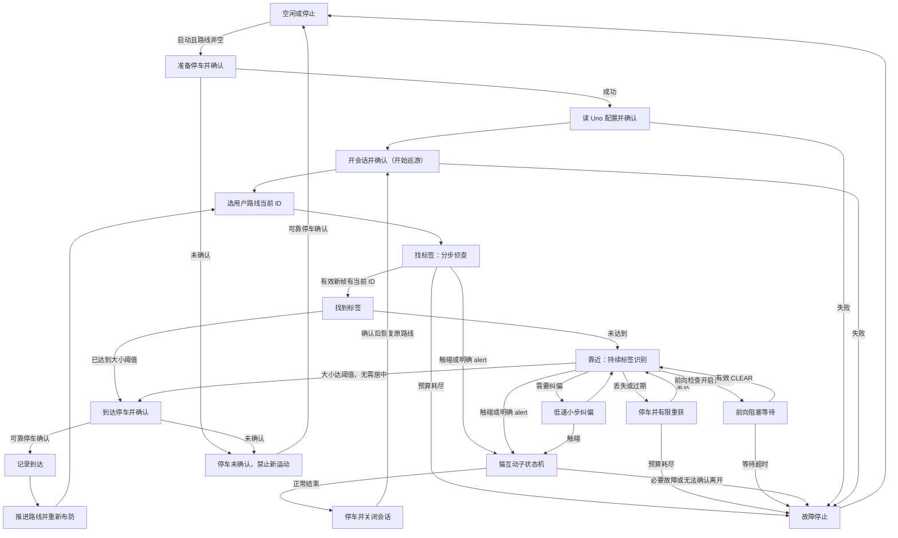
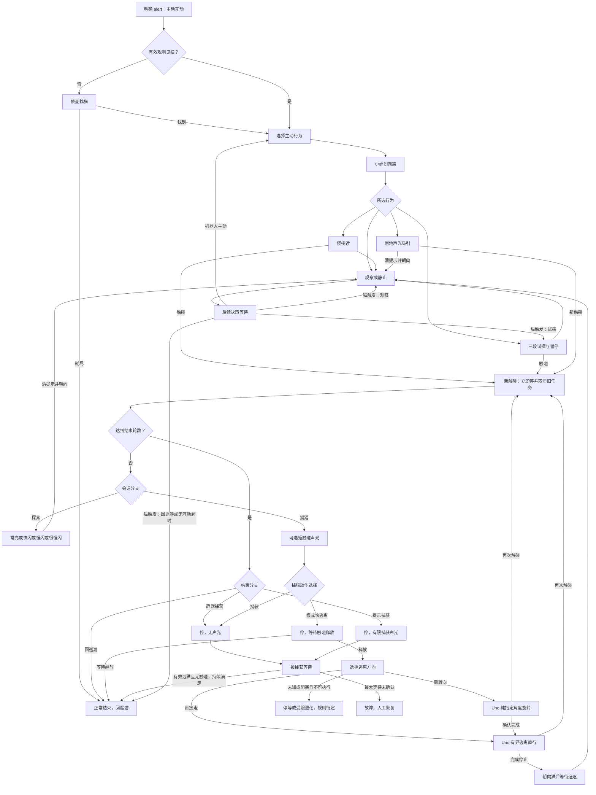
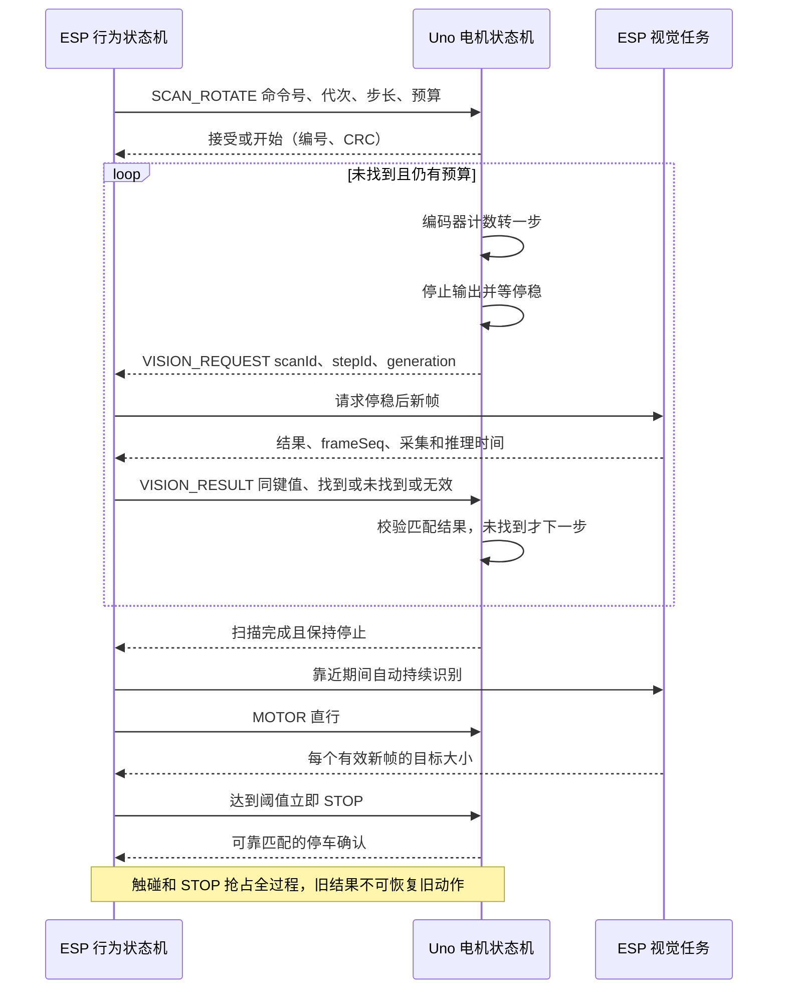
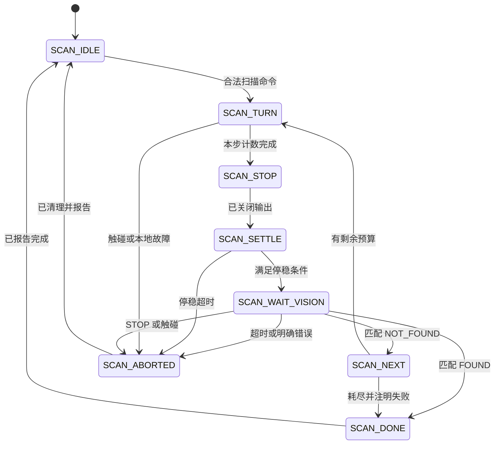

# 机器人状态机、流转图与测试清单

日期：2026-10-03。本文用于后续实施与验收，**设计表和图不代表新状态机已实现**。现有状态与新增状态分别标明；PWM、角度、时延的理论值也不等同于实机测量。

现场限制：用户报告 Uno 失联，用户不在旁边，不能 RESET。停止实机测试，不再复位、上传或发送运动命令。取消后检查未发现仍运行的 `pwm-characterize.py`，也未发现可确认的分级测量结果文件。后续先做离线工作。

## 1. 现状与需求边界

| 项目 | 已核查现状 | 目标／未定项 |
|---|---|---|
| 最近固件 | ESP `ESP32_CAT_HOST_0.11`、Uno `UNO_CAT_V6.5`；本次没有重新读板确认 | 最近烧录版本不证明当前设备健康 |
| PWM | V6.5 非零驱动下限由 120 改为 1，两份源码同步，已编译上传 | 最低启动／维持 PWM 尚未测得 |
| 路线 | 用户保存任意有序标签 ID 数组，末尾循环 | 不写死数量、顺序、ID；重复 ID 需重新布防 |
| 标签策略 | 搜索／对准／前进共用 `SCAN_TAG`；先居中再判断宽度 | 拆成找标签与靠近；正确 ID 一出现即 FOUND；到达不要求居中 |
| 标签停止大小 | `tagStopWidth` 是标签宽度／画面宽度，现值 0.25 | 单独可调，不能作为找到门槛；新默认值未定，不能混用面积百分比 |
| 视觉 | 当前周期任务，未实现 Uno 停稳请求识别 | 搜索停稳才识别，靠近自动持续识别，网页持续开关另行仲裁 |
| 前向 | 仅 ESP 判断并 STOP，有网页开关 | 关闭不伪造已校准；Uno 不检查前向 |
| 左右超声波 | Uno 执行，默认／最小 1 cm；只有新鲜有效距离严格小于阈值才停 | 无效／过期不因侧向检查停，也不能标成已确认畅通 |
| 连续运动 | KEEP／续行租约已删除 | 保留一次命令至 STOP／新命令／本地中止；有界动作本地完成 |
| 停车 | CRC 正确且编号匹配的 DONE MOTOR_STOPPED 才确认；300 ms 重试最多三次 | 停车未确认禁止下一运动 |
| 猫触发 | 真实触碰或明确 alert；仅看到猫不打断巡游 | 猫事件最高行为优先级；操作员 STOP、内存锁定等停车约束仍优先 |

依据：`esp32-host/ESP32CatHost/policy.cpp`、`policy_defaults.h`、ESP 主固件、两份 `UnoCatController.ino`、`app.mjs`、项目日志。下面“拟”指设计新增；有既有 action 名也不意味着已具备新时序。

## 2. 动作接口放在哪一层

ESP 负责目标、路线、识别、行为分支和前向停车；Uno 负责电机、编码器、局部触碰／侧向／失速停车、动作完成、停稳、声光执行。猫行为随机选择先保留 ESP，避免两边各自选分支。

| 动作 | 接口与归属 | 应用状态 | 完成规则 |
|---|---|---|---|
| 带侦查的小步旋转 | **拟 SCAN_ROTATE**：方向、步角／脉冲、PWM、停稳、识别超时、总预算；Uno 执行，ESP 识别 | 找标签、找猫 | 转一步→停稳→请求识别→匹配结果；未找到才下一步 |
| 看目标的小步纠偏 | 拟 SCAN_ROTATE 单步／小角度模式 | 标签偏侧、朝向猫 | 低速短步，停后看新帧；标签居中不作到达门槛 |
| 指定角度，不侦查 | **现有 ROTATE angle pwm**；Uno 本地计数完成 | 逃离转向、明确重定向、标定 | 不等待 ESP 下一帧来停车，也不自动请求识别 |
| 持续旋转，不侦查 | 现有 MOTOR +p -p 或反向 | 手动／标定／明确连续旋转 | 显式 STOP／新命令／本地中止；不作为默认搜索 |
| 直行，实时看目标 | 现有 MOTOR p p；ESP 处理每个新观测 | 靠近标签／需要视觉反馈的接近猫 | 到达立即 STOP；确认后才推进 |
| 有界距离直行 | 现有 DRIVE／计数动作，实施前核查语义；Uno 本地完成 | 三段试探、逃离、PWM 测量 | 脉冲／本地时限完成，不能靠网页延时停止 |
| 声光 | LED ON/OFF/FLASH、BEEP；ESP 选模式，Uno 非阻塞执行 | 探索、主动吸引、可选触碰提示、捕获提示 | 模式有限，退出清理，避免旧声光残留 |
| 中止 | Uno 本地抢占＋ESP STOP 确认 | 触碰、必要故障、用户停止 | 清旧动作与视觉代次；发送停止不等于已停 |

SCAN_ROTATE 是有界动作，不是续行租约。识别结果是新观察，不是保活。纯旋转与侦查旋转必须不同接口。

## 3. 全局优先级与状态

优先级：①操作员停止／内存锁定／必要本地停车；②猫触碰，抢占普通行为；③目标达到到达阈值／启用的前向检查停车；④完成、超时和收尾；⑤普通搜索、接近和声光。猫事件不能解除停车锁定。

| 状态 | 现有对应 | 入口功能 | 出口 |
|---|---|---|---|
| 空闲 | IDLE | 电机停，未启动 | 用户启动且路线非空→准备停车 |
| 准备停车 | WAIT_PATROL_STOP | STOP 并等可靠确认 | 成功→读配置；失败→停车未确认 |
| 模拟几何设置 | WAIT_PATROL_GEOMETRY | 仅 SIM 设置几何 | 确认→读配置；UART 不用保存值冒充回读 |
| 读真实配置 | WAIT_PATROL_CONFIG | GET_CONFIG，仅认本请求非零编号 DATA/DONE | 几何合法且确认→开会话；失败→故障 |
| 开会话 | WAIT_SESSION_START | SESSION_START，取得标签识别权限 | 确认→巡游；失败→故障 |
| 巡游 | PATROL | 用户路线和找／靠近子状态 | 触碰／alert→互动；停止／故障→收尾 |
| 猫互动 | INTERACTION | 保存发起方、轮数、固定分支、总时限 | 正常结束→关会话；故障→停止 |
| 关会话 | ENDING / WAIT_SESSION_STOP | 停车并关闭会话；清旧声光和请求 | 正常互动结束→重开并恢复路线；用户停止不重启 |
| 已停止 | STOPPED | 显示实际停止原因与确认状态 | 用户明确启动／恢复→准备流程 |
| 故障 | FAULT，当前在 STOPPED 下 | 清队列、STOP、记录上下文 | 区分可恢复与须 RESET 的 Uno 锁定 |
| 停车未确认 | stopUnconfirmed，拟明确显示 | 禁止后续运动，保留停止重试入口 | 可靠停车确认→停止；ACK/PING 不算 |
| Uno 失联／复位 | link timeout / READY | 冻结流程和测量；旧事务作废 | 用户恢复后重读配置，不能续跑旧动作 |

## 4. 巡游全部子状态

| 状态 | 现状／拟名称 | 使用能力 | 转移条件 |
|---|---|---|---|
| 选当前标签 | 拟 PATROL_SELECT_TARGET | ESP 取用户路线 ID | →找标签；重复 ID 先重新布防 |
| 找标签 | SCAN_TAG 缺目标分支→拟 TAG_SEARCH | Uno 侦查旋转＋ESP 停稳识别 | 新帧有当前 ID→找到；预算耗尽→失败 |
| 找到 | 拟 TAG_FOUND | 取消后续扫描，保存真实观察 | 已达到大小→停车；否则→靠近／纠偏；无需居中或 25% |
| 小步纠偏 | 当前连续对转→拟 TAG_ALIGN_STEP | 低速单步侦查 | 新帧评估后靠近或继续小步；丢失→重获 |
| 靠近标签 | SCAN_TAG 直行分支→拟 TAG_APPROACH | 直行＋自动持续 TAGS | 大小达阈值→到达停车；偏侧→纠偏；丢失→暂停 |
| 丢失暂停／重获 | 拟 TAG_REACQUIRE | STOP 确认后有限侦查 | 重获→靠近；独立预算耗尽→故障 |
| 前向等待 | 拟 FRONT_WAIT | 仅 ESP 开关开启才检查／停车 | 有效 CLEAR→重新评估；超时按前向规则收尾 |
| 到达停车确认 | 拟 TAG_ARRIVAL_STOP | 达大小立即 STOP，不要求居中 | 确认→记录到达；未确认不推进路线 |
| 已到达 | 当前 TAG_REACHED 日志→拟状态 | 记录 ID／索引／帧／大小／命令号 | →下一节点重新布防 |
| 重新布防 | 当前只有 500 ms 等待→拟 TAG_REARM | 目标消失／离开阈值／明确新段规则 | 满足后找下一标签；同帧不得跨多个节点 |
| 搜索方向受阻 | 当前侧向停车后有限反向 | Uno 停，ESP 决定有限换向 | 确认停妥后搜索；阻塞／预算耗尽→故障 |
| 搜索失败 | tag search exhausted | 停并区分时间／角度／步骤原因 | 人工恢复；已找到的靠近超时不能叫从未找到 |

网页主状态显示“找标签／靠近标签”，同时显示转动、停稳、等待识别、纠偏、重获、停车确认等子步骤，以及实际路线位置、目标 ID、大小／阈值、观测年龄和命令确认。

## 5. 所有猫行为

### 5.1 未互动和机器人主动互动

| 状态／事件 | 现有对应 | 动作／声光 | 转移 |
|---|---|---|---|
| 巡游看到猫 | cat.detected | 只更新观察，不增加声光 | 维持巡游；触碰或明确 alert 才互动 |
| 主动互动触发 | policyControl alert，仅 PATROL | STOP，发起方 ROBOT_SEARCH | 未见→找猫；已见→行为选择 |
| 找猫 | SEARCH_CAT | 拟侦查旋转 | 找到→朝向／选择；耗尽→结束互动 |
| 朝向猫 | FACE_CAT | 拟小步侦查纠偏 | 大致朝向→已选行为；丢失→有限找猫 |
| 远猫行为选择 | chooseRobot | ESP 概率／冷却；现以图像宽度分远近 | 慢接近或三段试探 |
| 慢接近 | APPROACH_CAT | 直行／有界直行，视觉可中止，无默认声光 | 完成→朝向观察；触碰→猫触发；丢失→停止收尾 |
| 试探行进 1／2／3 | PROBE_DRIVE + step | 有界直行，无默认声光 | 每段完成→暂停；触碰立即抢占 |
| 试探暂停 1／2／3 | PROBE_PAUSE | 停，按需观察 | 到时→下一段；第三段后→朝向观察 |
| 近猫行为选择 | chooseRobot | ESP 抽样 | 声光吸引／观察／静止 |
| 原地声光吸引 | STAY_SIGNAL→SIGNAL | 停，LED FLASH＋配置 BEEP | 完成关灯→朝向→观察 |
| 原地观察 | OBSERVE | 停，观察猫，无声光 | 时间到→后续决策等待 |
| 原地静止 | STAY 当前合并到 OBSERVE | 停，无声光 | 当前无独立执行区别；应明确合并或定义真实差异 |
| 后续决策等待 | FOLLOW_WAIT，ROBOT_SEARCH | 停，按决策时间而非每帧抽样 | 重新选择；会话超时→结束 |

### 5.2 猫触发的声光探索和捕猎

| 状态／事件 | 现有对应 | 动作／声光 | 转移 |
|---|---|---|---|
| 新触碰 | onTouch 四面 | Uno 即时停，ESP 取消旧动作／视觉代次，记录轮次 | 防抖后分支／结束选择；按住不重复计轮 |
| 会话分支选择 | branch 0/1 | ESP 每会话选一次 | 探索声光或捕猎 |
| 探索常亮 | signal(true) pattern 0 | 停，LED ON＋有限 BEEP | 完成关灯→朝向→观察 |
| 探索快闪 | pattern 1 | 停，快 FLASH＋BEEP | 同上 |
| 探索慢闪 | pattern 2 | 停，慢 FLASH＋BEEP | 同上 |
| 探索很慢闪 | pattern 3 | 停，很慢 FLASH＋BEEP | 同上；模式池避免立即重复 |
| 捕猎可选触碰提示 | touchFlashPercent | 短闪／BEEP 后进入捕猎，不属于探索模式 | 捕猎选择 |
| 捕猎动作选择 | touchPrey/Slow/FastEscape | 一次抽样，不逐帧重选 | 静默被捕获／慢逃／快逃 |
| 静默被捕获 | prey(false)→PREY_WAIT | 停；拟显式清除旧声光 | 确认离开→结束；无法确认超时→故障 |
| 等待触碰释放 | WAIT_RELEASE | 停，不边按住边逃跑 | 全部释放→逃离方向；释放超时→停止收尾 |
| 逃离方向选择 | 当前隐含于 onTouch→拟独立 | ESP 按触碰／猫位置／有效侧距选择 | 纯转角或直接直行；未知／阻塞退化规则未定 |
| 慢／快逃离转向 | ESCAPE_TURN，当前 MOTOR＋ESP 角度 | 拟 Uno 纯 ROTATE，不侦查 | 完成→有界直行；触碰→取消并等待释放 |
| 慢／快逃离直行 | ESCAPE_DRIVE | Uno 有界距离，不同可调 PWM，无默认声光 | 完成停→朝向并等待追逐；新触碰→猫响应 |
| 等待追逐 | WAIT_CHASE | 停，不能延续逃离 | 到时→朝向并观察；触碰→新轮 |
| 猫后续决策 | FOLLOW_WAIT，CAT_TOUCH | 每轮最多一次抽样，带试探冷却 | 试探／观察／结束；无触碰超时结束 |
| 逃离中再触碰 | onTouch 特殊分支 | 即时停，废弃旧完成通知及排队直行 | 重新等待释放，不让旧 ROTATE DONE 启动旧逃离 |

逃离方案未最终选定：不把“看见猫”直接等同转 180°。倾向 ESP 选方向、Uno 执行；有效侧距能辅助，但无效不等于畅通。没有后向超声波，REAR 是触碰输入。未知时是否有限逃离、具体角度／距离／速度应明确配置与规则，不能擅自写死。

### 5.3 结束与捕获等待

| 状态 | 现有对应 | 动作／声光 | 转移 |
|---|---|---|---|
| 达结束轮次的选择 | endingAfterRounds 抽样 | ESP 选回巡游／静默捕获／提示捕获 | 三分支 |
| 直接回巡游 | finish | STOP、清声光、关会话 | 确认后重开，继续原路线索引 |
| 静默捕获 | prey(false) | 停，无新增声光并清旧提示 | 捕获等待 |
| 提示捕获 | prey(true) | 停，有限 LED FLASH＋BEEP | 提示结束仍停，捕获等待；区别于探索 |
| 捕获等待 | PREY_WAIT | 有效看到猫较远、无触碰，连续满足离开时间 | 确认离开→结束；未检测到猫不能证明离开 |
| 捕获等待超时 | MAX_WAIT_UNCONFIRMED | 停，显示无法确认 | 人工恢复，不悄悄继续巡游 |
| 会话／无触碰超时 | sessionLimit / endingInactivity | 正常结束；PREY_WAIT 用独立上限 | 停车和会话确认后回巡游 |

保留现有默认概率：探索／捕猎 20/80；捕猎捕获／慢逃／快逃 20/40/40；猫后续试探／观察／巡游 5/35/60；结束巡游／静默捕获／提示捕获 40/30/30。不要重构时无声改变概率与冷却。四面映射 LEFT=0、RIGHT=1、REAR=2、TOP=3。

### 5.4 非互动的手动、维护及并行模式

这些是与主行为并行的模式或维护状态，不应把所有组合再生成独立行为状态。维护操作不自动进入巡游，真实设备和模拟观察不能混用。

| 状态／模式 | 现有功能／目标 | 电机与视觉响应 | 转移／限制 |
|---|---|---|---|
| 手动直行／倒车 | MOTOR／有界 TEST_MOTOR | 用户指定 PWM；测试有本地时限 | STOP／到时／本地中止→停止；需人现场 |
| 手动持续转向 | 两轮异向 MOTOR | 不侦查，只有明确手动输入执行 | 显式 STOP 或本地中止，不借巡游开始 |
| 手动指定角度／距离 | ROTATE／DRIVE | Uno 本地计数，默认不侦查 | 完成／中止→停止；无角度反馈不能伪装完成 |
| PWM 标定 | pwm-characterize.py，当前暂停 | 每档有界执行，读真实脉冲 | 上一档停止确认后才下一档；失联终止 |
| 配置／路线编辑 | 网页保存、GET_CONFIG 等 | 停止时配置；不驱动车轮 | 保存回读并核对核心生效；不自动启动 |
| 地面参考采集／前向校准 | ESP 参考与相机计算 | 独立视觉维护，无电机动作 | 采集成功／失败要明确；ROI 改动使旧参考失效，不伪造成功 |
| 视频预览 | 相机流／缓存 | 不因打开视频就自动开启控制或互动 | 与识别权限分开，可开关 |
| 视觉 OFF／CAT／TAGS／BOTH | 当前识别模式 | 由网页请求和行为必要识别共同仲裁 | 靠近要求 TAGS；猫互动按需 CAT；不以 UI OFF 关闭必要控制观察 |
| UART／SIM_UNO | 实际下位机／模拟模式 | 同一时刻明确观察来源 | 模式切换先确认停止并作废旧事务；模拟不能刷新真实观测 |
| LIVE／DRY_RUN | 真实输出／执行门禁 | 真实电机验收使用 LIVE，用户不希望用 DRY_RUN 替代 | 明确显示，不擅自换模式后宣称轮子已验证 |
| 心跳／遥测／内存诊断 | 独立后台任务 | 无电机命令；异常可触发全局故障 | 限流不堵串口；心跳不能替代传感器或停车确认 |
| 固件维护／重新初始化 | 上传、RESET、握手、回读 | 只在人确认且授权后执行 | 当前禁止；恢复后重读真实配置，不续旧运动 |

## 6. Uno 侦查内层状态（拟新增）

| 状态 | 电机／通信 | 下一状态 |
|---|---|---|
| SCAN_IDLE | 无扫描，校验新命令和预算 | 合法→转动；非法→拒绝 |
| SCAN_TURN | 本地低 PWM 按脉冲转一步 | 到计数→停；触碰／失速／STOP→中止 |
| SCAN_STOP | 关闭输出并记录计数 | →停稳等待；PWM=0 不能证明机械停稳 |
| SCAN_SETTLE | 最小等待＋可选编码器静止窗口 | 停稳→请求识别；停稳超时→中止 |
| SCAN_WAIT_VISION | 保持停，发一次识别请求，可有限重发 | 匹配 FOUND→完成；NOT_FOUND→下一步；超时／错误→中止 |
| SCAN_NEXT | 检查总角度／步数／耗时预算 | 有预算→转；耗尽→失败完成 |
| SCAN_DONE | 保持停，可靠完成报告注明结果 | →空闲，ESP 切下一行为 |
| SCAN_ABORTED | 即时停，清旧事务，报告真实原因 | →空闲／故障，不自行续跑 |

协议语义草案：VISION_REQUEST(scanId, stepId, generation)，VISION_RESULT(同键值, FOUND/NOT_FOUND/INVALID, observationRef)。最终 ASCII 字段、CRC 和帧长需按 AVR 缓冲与 SRAM 制定，当前尚不支持。

ESP 必须用停稳请求之后捕获的新帧，记录请求、采集、推理起止、回复。两板 millis 不直接比较，跨板按编号／步骤／事件先后关联。连续识别开启也不能把转动中旧帧当停稳帧。推理不能阻塞控制；旧推理即使完成也不得恢复被抢占动作。

## 7. 状态流转图

以下 Mermaid 表达目标设计，现状差异见表；源码代码块可直接给后续会话。全局抢占适用于每个活动状态，图中不重复画所有边。

### 7.1 全局与巡游

任何状态遇到操作员 STOP、内存锁定或必要本地停车均先停止；失联冻结流程，不继续测试。正常互动收尾恢复路线，用户停止不能走自动恢复边。

### 7.2 猫互动、声光与捕猎

所有普通互动状态都可被新触碰抢占；总会话时限触发正常结束。持续按住不计多轮。探索和捕获声光是不同分支；静默捕获清旧提示。

### 7.3 转动—停稳—识别握手

## 8. 角度、帧率和时序依据

- 既有只读 BOTH 样本耗时 477–531 ms；相机缓存更新约 5.06 fps。它不是浏览器流帧率或识别 fps。考虑推理后约 200 ms 等待，BOTH 识别频率粗估 1.3–1.5 次/秒，未直接统计；TAGS-only 待测。
- 轮径 67.5 mm、轮距 120 mm、每轮 20 脉冲/转：轮程约 10.60 mm/脉冲；单轮一个脉冲约 5.06°，两轮对转各一个约 10.125°。仅理想运动学分辨率，惯性／滑移／间隙未测，不能承诺 1°。
- ESP `angle()` 当前多除一个 PI，使估计偏小约 π 倍，影响搜索预算和逃离；Uno ROTATE 计数公式理论正确并至少一个脉冲，方向与双编码器完成规则仍需测试。
- 500 ms 速度窗口内，一脉冲相当于 6 RPM；低速量化需用更长窗口和累计计数对照。
- 57600、8N1 每字节约 0.174 ms；15–25 字节纯线路约 2.6–4.3 ms，不含排队、软件串口、CRC 错误、重试。此前一次损坏后 STOP 首发至确认约 661 ms，不能当平均延迟。
- 角度计数停车放 Uno；额外记录关输出后滑行脉冲，不能根据网页停止或 PWM=0 宣称实际转角准确。

## 9. To-do：先离线，后现场

### P0：协议和核心状态机

- [ ] 核对 V6.5 USB 握手，`app.mjs` 仍期待 V6.4；同步说明。
- [ ] 定义 SCAN_ROTATE 和识别握手字段、帧长、CRC、编号、代次、重复／超时／完成／中止语义；保留纯 ROTATE 和 MOTOR。
- [ ] Uno 非阻塞扫描内层状态机；所有步骤有预算，触碰／STOP 即时取消，不能恢复旧事务。
- [ ] ESP 停稳后新帧队列，重复请求去重，旧结果拒绝；推理不阻塞 UART 和控制。
- [ ] 拆分标签搜索／找到／靠近／重获／到达停车；独立预算，到达判断优先于居中纠偏。
- [ ] 靠近自动持续识别且新帧直达停止决策；可靠停妥才推进路线。
- [ ] 统一视觉权限：停稳请求、接近持续请求、猫互动、网页持续开关；预览独立。
- [ ] 猫抢占覆盖扫描／推理等待／直行／ROTATE；操作员停车与故障锁定不可被猫事件覆盖。
- [ ] 修复 ESP 角度换算，统一计数、方向、累计和归零；逃离复用 Uno ROTATE。
- [ ] 保留 57600、无 KEEP、紧凑遥测、可靠 STOP、非零编号、真实观察不模拟补值。

### P1：配置与界面真正接入

- [ ] 主状态／子步骤、目标／路线、大小／阈值、观测年龄、命令确认由真实策略快照显示，不拿旧 vision.policy 冒充当前状态。
- [ ] 单独可调到达大小，明确宽度或面积单位、范围、保存回读；新默认值待确定。
- [ ] 重复 ID／单节点／循环重新布防，不用同帧跳节点；互动回来保留原路线进度。
- [ ] ESP 核心接入 captureCueFlashMs、captureCueBeepMs、touchFeedbackBeepMs，当前对应路径硬编码；不是只改 USB 页面。
- [ ] alignTimeoutMs、finalSearchTimeoutMs 接入或标不支持；farCatThresholdCm、catLeaveDistanceCm 不能冒充相机厘米测距。
- [ ] 明确 STAY 与 OBSERVE 合并或真实差异；声光退出清理，探索与捕获提示分开。
- [ ] 明确逃离规则和未知输入处理；前向关闭时逃离不要被无关旧视觉卡住。
- [ ] 多标签＋角点＋floor 大包超过约 4096 字节不能 toCharArray 静默截断；显式丢包／队列计数，保留核心目标数据。
- [ ] 地面 ROI 修改使旧校准失效；几何显示区分 ESP 保存与 Uno 真回读。
- [ ] 故障显示分开历史动作与当前输出，修正“#0 仍显示旧 PWM”；记录驻留时间和转移原因。

### P2：人在现场、Uno 恢复后才做

- [ ] 用户确认固定架空、接线、可停止；先空闲通信稳定。失联立即停，不继续递增 PWM。
- [ ] 左右轮正反分别测启动和维持 PWM、真实脉冲／RPM，记录供电；架空与落地负载分开。
- [ ] 每档 Uno 本地有界时长，上一档可靠停止才下一档；记录发起／发送／MS／MP／MD／停车确认。
- [ ] 实测选择扫描 PWM、可靠最小步角／脉冲和停稳窗口，记录滑行、误差与重复性。
- [ ] 分测 TAGS／CAT／BOTH 的采集、推理、周期、排队；UART 往返分布而非只算线路时间。
- [ ] CRC、内存、心跳、uptime、复位前 Stage 与独立 COM10 字节关联，失联根因单独查，不擅改 57600 或接线。
- [ ] 短功能验收后再做至少 10 分钟空闲／通信／巡游分开的稳定观察；失联保留现场，等用户恢复，不自动 RESET／烧录。

## 10. 测试矩阵

| 测试 | 离线覆盖 | 实机通过条件 |
|---|---|---|
| 路线 | 任意顺序／长度／空／重复 ID | 用户输入至少两节点，按序到达与循环 |
| 找到 vs 到达 | 小标签正确 ID 即 FOUND；错误 ID 不切 | 小标签先靠近；大小达阈值停，偏侧也停 |
| 实时接近 | 新帧直达 STOP，不等网页／扫描结束 | 记录越阈值帧→STOP→确认和滑行时间 |
| 丢失与预算 | 丢失暂停、有限重获、独立搜索／接近计时 | 遮挡停、恢复重获，不沿用旧搜索耗尽 |
| 侦查旋转 | 转／停／停稳／识别／再转，有界超时 | 确实停着看新帧，低 PWM 稳定起转 |
| 纯角度旋转 | 本地计数结束，不请求识别 | 实际转角和重复性，不依赖相机结束 |
| 连续 MOTOR | 无 KEEP，新命令／STOP／局部中止 | 仅人现场明确测试，不借失联试无限运行 |
| 协议异常 | CRC 错、0号、错号、乱序、重复、丢结果 | 错包不误驱动，实际重试可追溯 |
| 停车确认 | STOP 丢失／耗尽不推进 | 未确认无下一档／节点，UI 明示 |
| 猫抢占 | 扫描每子步骤、靠近、旋转、推理返回时事件 | 四面立即停，旧通知不重启，按住不重复计轮 |
| 探索声光 | 四模式／模式池／轮数／防抖 | LED、BEEP 时长与配置一致，退出无残留 |
| 捕猎逃离 | 捕获／慢逃／快逃／再触碰／释放超时 | 有界角度与距离，未知不显示畅通 |
| 主动互动 | alert、只看猫不触发、冷却、三段试探 | 找猫、朝向、观察及等待符合表 |
| 捕获结束 | 有效远猫窗口；消失不等于离开；超时 | 两种提示差异、停等、未确认须人工恢复 |
| 安全边界 | 0.5 cm 停、1.0 cm 允许，无效过期继续 | 前向仅 ESP，局部触碰／失速／内存仍有效 |
| 配置核心接入 | UI→保存→回读→真实动作分支 | 改阈值／声光时长确实改变行为 |
| 大包与队列 | 超长不截断，掉包可观察 | 推理繁忙下控制及时，诊断无新增异常 |
| 失联 | 不以陈旧数据刷新有效性，复位旧事务失效 | 独立 UART／uptime 证据；无人时停止测试 |

推荐转移日志字段：phase、action、reason、targetId、routeIndex、generation、commandId、scanId、stepId、frameSeq、observationAgeMs、requestedPwm、checkedPulses、stopConfirmed。高频数据另行限流，不能诊断输出淹没串口。

交付证据分开：源码测试、编译、烧录、实机功能、长期稳定性；前者不能替代后者。
